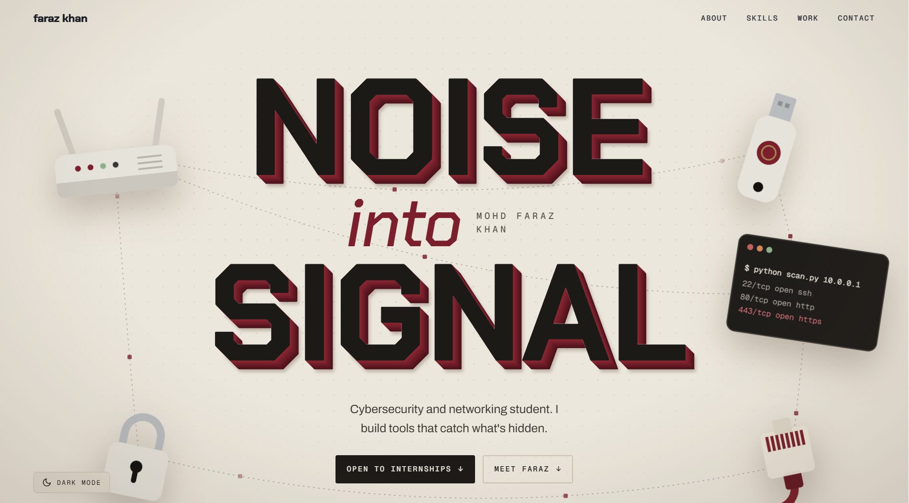
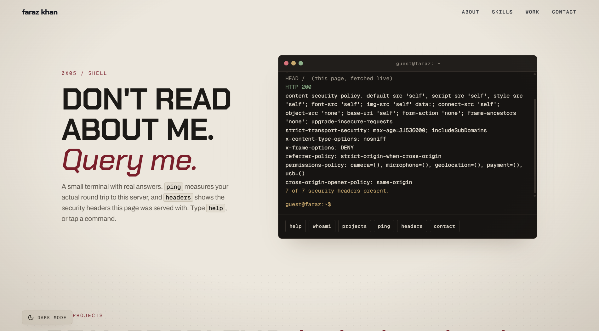

# Portfolio: mohdfarazkhan.pages.dev

My personal site, live at **https://mohdfarazkhan.pages.dev**.





## What's in it
- Hand-written HTML, CSS and JavaScript. No framework, no build step.
- Scroll animation with GSAP, ScrollTrigger and Lenis (vendored in `vendor/`).
- A small in-page terminal (`help`, `whoami`, `projects`, `ping`, `headers`) that reports the security headers the page was served with.
- Strict security headers via `_headers` (Content-Security-Policy, HSTS, X-Frame-Options and more), a `security.txt`, and self-hosted fonts so nothing loads from third parties.
- Privacy policy for my Android app Footprint under `footprint/`.

## Run locally
Open `index.html` in a browser, or serve the folder:

```
python -m http.server 8000
```

Deployed on Cloudflare Pages, which applies `_headers` automatically.
